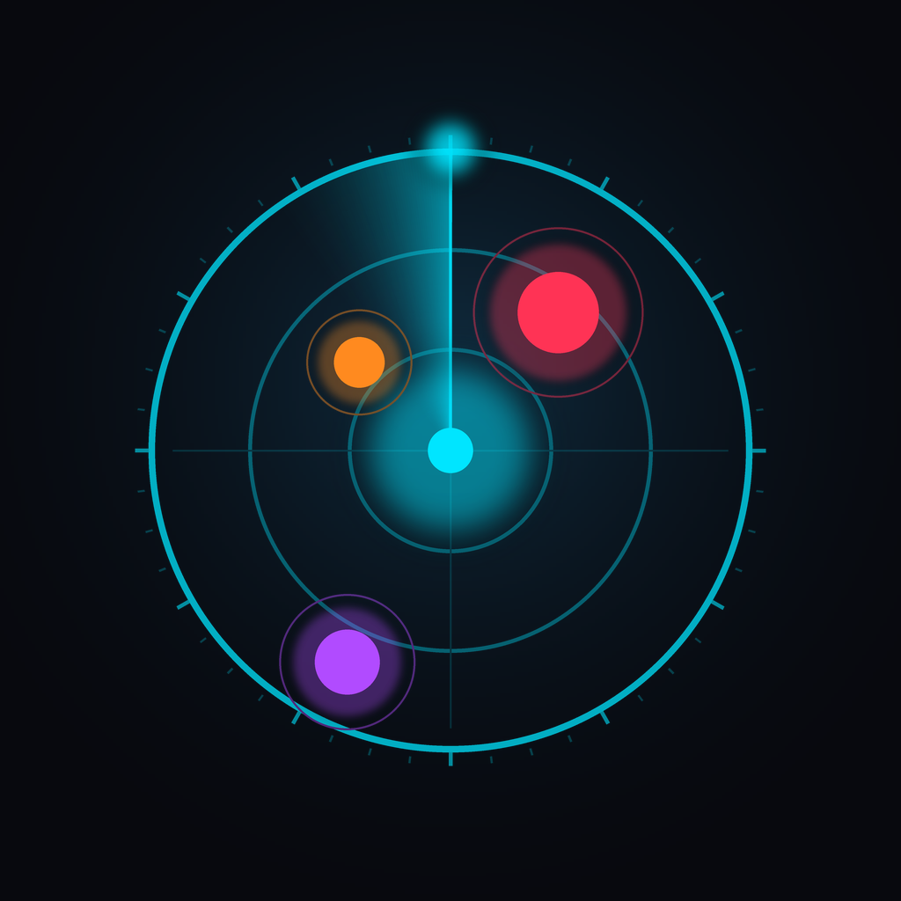

# Bluetooth Finder Radar · رادار الأجهزة المفقودة



An offline, ultra-dark “cyber radar” that turns Bluetooth Low Energy advertisements
into a live proximity radar, so you can walk towards a lost pair of earbuds, a watch,
a tracker tag or an unnamed beacon.

* **Platform:** Android (portrait), Flutter 3.27+, ARM64 optimized release APK
* **BLE stack:** [`flutter_blue_plus`](https://pub.dev/packages/flutter_blue_plus) 1.35.x
* **Signal model:** log-distance path loss + exponential moving average
* **Feedback:** Geiger-counter audio + haptics, 360° sweep assistant, confetti on “found”
* **Network:** none. No analytics, no ads, no location inference, no cloud.

---

## Download the APK

| What | Where |
| ---- | ----- |
| **Latest signed-for-testing ARM64 APK** | [**app-release.apk (v1.0.0)**](https://github.com/Hacker5055/app-2/releases/download/apk-latest/app-release.apk) · [all releases](https://github.com/Hacker5055/app-2/releases) |
| Build logs / artifacts | [GitHub Actions](https://github.com/Hacker5055/app-2/actions/workflows/android-release.yml) |

The APK is produced by CI on every push to `main` (and on this branch) with
exactly the command in the next section, then published to the rolling
`apk-latest` release — 18.2 MB, `arm64-v8a` only, R8 + resource shrinking,
signed with the debug keystore (installable, not Play-publishable).

Install it with `adb install -r app-release.apk`, or open the link on the phone
and allow "install unknown apps" for your browser.

---

## Table of contents

1. [Quick start](#quick-start)
2. [Build the ARM64 release APK](#build-the-arm64-release-apk)
3. [AndroidManifest.xml (complete)](#androidmanifestxml-complete)
4. [How the radar math works](#how-the-radar-math-works)
5. [Proximity zones](#proximity-zones)
6. [Permissions](#permissions)
7. [Mock BLE data mode](#mock-ble-data-mode)
8. [Architecture](#architecture)
9. [Screens](#screens)
10. [Localization](#localization)
11. [Tests](#tests)
12. [Interactive preview](#interactive-preview)
13. [Troubleshooting](#troubleshooting)
14. [Privacy](#privacy)

---

## Quick start

```bash
flutter --version          # 3.27.0 or newer, Dart 3.6+
flutter pub get
flutter run                # debug on a real device (BLE needs hardware)
```

On an emulator — which has no Bluetooth radio — start the app and tap
**Continue in demo mode**, or enable **Mock mode** in Settings. The whole radar,
including smoothing, zoning, Geiger cadence and the sweep assistant, runs against
a deterministic simulator so nothing has to be faked in the UI layer.

---

## Build the ARM64 release APK

The deliverable build is a single, arm64-v8a only, minified release APK.
It is built automatically by [`.github/workflows/android-release.yml`](.github/workflows/android-release.yml)
on every push; the same command works locally:

```bash
flutter clean
flutter pub get
flutter build apk --release --target-platform android-arm64
```

Output:

```text
build/app/outputs/flutter-apk/app-release.apk
```

Install and inspect it:

```bash
adb install -r build/app/outputs/flutter-apk/app-release.apk
aapt dump badging build/app/outputs/flutter-apk/app-release.apk | grep -E "package|native-code"
# native-code: 'arm64-v8a'
```

Optional variants:

```bash
# Separate APKs per ABI (smaller downloads for Play)
flutter build apk --release --split-per-abi

# App bundle for Google Play
flutter build appbundle --release
```

**Release signing.** The build falls back to the debug keystore so the command above
always produces an installable APK. For a publishable build, copy
`android/key.properties.example` to `android/key.properties`, fill in the keystore
details, then rebuild. Signing, shrinking and R8 rules live in
[`android/app/build.gradle`](android/app/build.gradle) and
[`android/app/proguard-rules.pro`](android/app/proguard-rules.pro).

Full toolchain notes: [`docs/BUILD_AND_RELEASE.md`](docs/BUILD_AND_RELEASE.md).

---

## AndroidManifest.xml (complete)

The production manifest is at
[`android/app/src/main/AndroidManifest.xml`](android/app/src/main/AndroidManifest.xml)
and reproduced here in full.

```xml
<manifest xmlns:android="http://schemas.android.com/apk/res/android"
    xmlns:tools="http://schemas.android.com/tools">

    <!--
         Bluetooth Finder Radar: permission model.

         Android 12+ (API 31+): the runtime "Nearby devices" group.
           * BLUETOOTH_SCAN: required to discover advertisements. It carries
             android:usesPermissionFlags="neverForLocation" because the app only
             derives proximity from RSSI and never tries to infer physical
             location; this also lets the Play review skip location checks.
           * BLUETOOTH_CONNECT: required to read the device name, discover GATT
             services and (optionally) trigger a find-my accessory alert.

         Android 11 and below (API 30 and lower): scanning is only allowed with a
         location permission, so ACCESS_FINE_LOCATION / ACCESS_COARSE_LOCATION are
         declared with maxSdkVersion="30" and requested at runtime on those OS
         versions. Legacy BLUETOOTH / BLUETOOTH_ADMIN are capped the same way.
    -->
    <uses-permission
        android:name="android.permission.BLUETOOTH"
        android:maxSdkVersion="30" />
    <uses-permission
        android:name="android.permission.BLUETOOTH_ADMIN"
        android:maxSdkVersion="30" />

    <uses-permission
        android:name="android.permission.BLUETOOTH_SCAN"
        android:usesPermissionFlags="neverForLocation"
        tools:targetApi="s" />
    <uses-permission android:name="android.permission.BLUETOOTH_CONNECT" />

    <uses-permission
        android:name="android.permission.ACCESS_FINE_LOCATION"
        android:maxSdkVersion="30" />
    <uses-permission
        android:name="android.permission.ACCESS_COARSE_LOCATION"
        android:maxSdkVersion="30" />

    <!-- BLE is the whole point: require it, and never fall back to a fake install. -->
    <uses-feature
        android:name="android.hardware.bluetooth_le"
        android:required="true" />
    <uses-feature
        android:name="android.hardware.bluetooth"
        android:required="true" />

    <application
        android:name="${applicationName}"
        android:icon="@mipmap/ic_launcher"
        android:label="@string/app_name"
        android:allowBackup="false"
        android:fullBackupContent="false"
        android:dataExtractionRules="@xml/data_extraction_rules"
        android:enableOnBackInvokedCallback="true"
        android:hardwareAccelerated="true"
        android:supportsRtl="true"
        android:theme="@style/NormalTheme"
        tools:targetApi="33">

        <activity
            android:name=".MainActivity"
            android:exported="true"
            android:launchMode="singleTop"
            android:screenOrientation="portrait"
            android:configChanges="orientation|keyboardHidden|keyboard|screenSize|smallestScreenSize|locale|layoutDirection|fontScale|screenLayout|density|uiMode"
            android:hardwareAccelerated="true"
            android:windowSoftInputMode="adjustResize"
            android:theme="@style/LaunchTheme">

            <!-- Flutter draws the first frame; the splash theme is only the cold-start frame. -->
            <meta-data
                android:name="io.flutter.embedding.android.NormalTheme"
                android:resource="@style/NormalTheme" />

            <intent-filter>
                <action android:name="android.intent.action.MAIN" />
                <category android:name="android.intent.category.LAUNCHER" />
            </intent-filter>
        </activity>

        <meta-data
            android:name="flutterEmbedding"
            android:value="2" />
    </application>

    <!-- Allow the permission dialogs / app settings deep-link to resolve. -->
    <queries>
        <intent>
            <action android:name="android.settings.BLUETOOTH_SETTINGS" />
        </intent>
        <intent>
            <action android:name="android.settings.APPLICATION_DETAILS_SETTINGS" />
        </intent>
    </queries>
</manifest>
```

Notes:

* `neverForLocation` is a promise, not a trick: the app never calls any location API and
  never derives coordinates. Play Console will not ask for a location declaration.
* `ACCESS_FINE_LOCATION` / `ACCESS_COARSE_LOCATION` are capped at API 30 because
  they are only needed on Android 11 and lower, where a BLE scan requires location
  permission. Android 12+ uses the “Nearby devices” runtime group instead.
* `minSdk 21`, `compileSdk 35`, `targetSdk 35` — set in
  [`android/app/build.gradle`](android/app/build.gradle).

---

## How the radar math works

Distance is estimated from the received signal strength with the log-distance
path-loss model:

```text
d = 10 ^ ((TxPower − RSSI) / (10 · n))
```

| Symbol    | Meaning                                   | Default            |
| --------- | ----------------------------------------- | ------------------ |
| `RSSI`    | received power of one advertisement, dBm  | —                  |
| `TxPower` | expected RSSI at exactly 1 m              | **−59 dBm**        |
| `n`       | path-loss exponent (2.0 free space … 3.5) | **2.5**            |
| `d`       | estimated distance, metres                | clamped 0.05 – 200 |

Raw RSSI jumps by ±10 dB whenever a body, a hand or a wall gets in the way, so every
packet first goes through an exponential moving average:

```text
s[0] = x[0]
s[i] = α · x[i] + (1 − α) · s[i−1]        α = 0.35
```

The UI is rebuilt **once per second** from the smoothed values, while packets keep
streaming into the filter. A single 20 dB spike moves the estimate by only ~7 dB,
which is what keeps radar nodes from teleporting across the screen.

The same numbers power the Geiger feedback: ping interval falls continuously from
1600 ms at the radar edge to 130 ms at arm's length, with a `t^0.65` curve so it
accelerates hard in the last metre.

Deeper dive: [`docs/SIGNAL_MODEL.md`](docs/SIGNAL_MODEL.md).

---

## Proximity zones

| Zone | Distance | Colour | Hex | Feedback |
| ---- | -------- | ------ | --- | -------- |
| **Immediate / Hot** | `< 1 m` | neon red | `#FF3355` | ping every 130 ms + haptic buzz |
| **Close / Warm** | `1 – 3 m` | electric orange | `#FF8A1F` | ping every ~380 ms |
| **Moderate** | `3 – 10 m` | vibrant purple | `#B14BFF` | ping every ~800 ms |
| **Far / Cold** | `> 10 m` | deep cyan | `#00E5FF` | ping every ~1600 ms |

Entering the hot zone triggers a haptic tick pattern and turns the radar rings red;
the same zone colours are reused by the device cards, the list chips and the sweep
assistant.

UI base colour is `#08090E` with glowing neon rings, high-contrast typography and a
monospace numeric style for every dBm / metre readout.

---

## Permissions

The app asks for everything it needs on first launch, in a single explainer screen
(`lib/ui/screens/permission_gate_screen.dart`):

| Android version | Runtime permissions requested |
| --------------- | ----------------------------- |
| 12+ (API 31+)   | `BLUETOOTH_SCAN`, `BLUETOOTH_CONNECT` |
| 11 and below    | `ACCESS_FINE_LOCATION` (+ `BLUETOOTH` / `BLUETOOTH_ADMIN` declared) |

States handled explicitly: `permissionRequired`, `permissionDenied`,
`permissionPermanentlyDenied` (deep-links to app settings), `adapterOff`
(offers the system “turn on Bluetooth” dialog), `adapterUnsupported`,
`unauthorized`, `initializing`, `scanning`, `error`, plus the demo-mode escape hatch.

---

## Mock BLE data mode

Toggle it in **Settings → Mock BLE data** (or use *Continue in demo mode* on the
permission gate). It swaps the real radio for `MockBleScannerService`, which emits
eight scripted devices every 350 ms through the *same* path-loss model and smoothing
pipeline:

| id | name | character |
| -- | ---- | --------- |
| `mock:airpods-pro-2` | AirPods Pro | earbuds, drifting around 0.7 m |
| `mock:galaxy-watch-6` | Galaxy Watch6 | watch with a heart-rate service UUID |
| `mock:smarttag-2` | Galaxy SmartTag2 | tracker |
| `mock:airtag` | AirTag | tracker, Find My manufacturer frame |
| `mock:mi-band-8` | Mi Band 8 | watch |
| `mock:tile-mate` | Tile Mate | tracker |
| `mock:wh-1000xm5` | Sony WH-1000XM5 | over-ear headphones |
| `mock:beacon-19a4` | *(unnamed)* | anonymous beacon |

Distances follow a bounded random walk, so zones, Geiger cadence, haptics and the
radar animation behave exactly as they do with real hardware.

---

## Architecture

Clean, layered, dependency-injected with `provider`:

```text
lib/
├── main.dart                     bootstrap + dependency graph
├── app.dart                      MaterialApp, theme, providers, gate
├── core/
│   ├── constants/                all tunable numbers (TxPower, n, zones, timings)
│   ├── theme/                    ultra-dark palette, typography, neon shadows
│   ├── localization/             AppStrings (EN + AR), AppLocalizations delegate
│   └── utils/                    formatters, stable pseudo-angles
├── domain/
│   ├── models/                   BleAdvertisement, BleDevice, zones, kinds, status
│   └── signal/                   path loss, EMA, azimuth estimator, Geiger cadence
├── data/
│   ├── services/                 BLE scanner (real + mock), permissions, audio,
│   │                             haptics, compass, GATT alert, prefs, display
│   └── repositories/             BleRepository — selects real vs mock scanner
├── controllers/                  BleController, DeviceTrackingController,
│                                 SettingsController, SweepAssistantController
└── ui/
    ├── screens/                  gate, home, scanner, radar, detail, settings
    ├── widgets/common/           cards, buttons, chips, signal bars, background
    ├── widgets/device/           device card, glyph, filter bar, empty state
    └── widgets/radar/            CustomPainter radar, sweep dial, sparkline,
                                  sweep assistant sheet
```

Data flow:

```text
advertisement ─► BleRepository ─► BleController
                                   ├─ EMA per device (α = 0.35)
                                   ├─ PathLossCalculator ─► metres
                                   ├─ zone + history (48 samples)
                                   └─ 1 s snapshot ─► UI
DeviceRadarScreen ─► DeviceTrackingController ─► Geiger ping + haptic cadence
SweepAssistant ─► compass headings + smoothed RSSI ─► AzimuthEstimator ─► bearing
```

More: [`docs/ARCHITECTURE.md`](docs/ARCHITECTURE.md).

---

## Screens

1. **Scanner / Filter home** — live device list sorted by distance, with name,
   MAC/UUID, dBm signal bars, estimated metres and filter tags
   *Earbuds · Watches · Trackers · Unknown*. Search, sort, radar range badge.
2. **Radar detail** — full-bleed radar with pulsing rings and a rotating sweep,
   live “0.8 meters away” readout (metric or imperial), RSSI sparkline,
   **Play Sound** (best-effort GATT alert), **Sweep 360°**, **Mark as Found**
   (confetti + success chime).
3. **Radar tab** — the master radar with every device as a tappable node.
4. **Settings** — mock mode, sound, haptics, units, language, TxPower and path-loss
   calibration, radar range, reset.

---

## Localization

Arabic (RTL) and English (LTR) are first class; the app follows the system locale
and can be switched from the gate or Settings. Every string lives in
`lib/core/localization/app_strings.dart`; the static checker verifies that both
dictionaries define the same keys. Arabic keeps Latin digits for dBm/metre values so
readings stay monospace-aligned.

---

## Tests

Pure-Dart unit tests cover the parts that must not regress:

```bash
flutter test
```

* `test/domain/path_loss_calculator_test.dart` — formula, clamps, calibration
* `test/domain/exponential_moving_average_test.dart` — smoothing, alpha, median filter
* `test/domain/proximity_zone_test.dart` — 1 m / 3 m / 10 m boundaries and colours
* `test/domain/ble_device_test.dart` — bars, geometry, ordering, copyWith
* `test/domain/azimuth_estimator_test.dart` — circular mean, 0°/360° seam
* `test/domain/proximity_pulse_test.dart` — Geiger cadence, intensity, volume
* `test/core/formatters_test.dart` — metric/imperial formatting
* `test/data/mock_ble_scanner_service_test.dart` — scripted simulator stream
* `test/widgets/signal_bars_test.dart` — bar meter widget

Two static checkers run without a Dart SDK (used while building this repository in a
sandbox), plus a headless smoke test for the HTML preview:

```bash
python3 tool/static_checks.py   # imports, constants, colour and string coverage
python3 tool/api_check.py       # member usage + constructor named arguments
node tool/preview_smoke.mjs     # preview UI flow test (needs jsdom)
```

---

## Interactive preview

`preview/index.html` is a self-contained, offline simulation of the app (canvas
radar, mock devices, filters, detail screen, sweep assistant, confetti). No network,
no build step — open it in any browser:

```bash
python3 -m http.server 8080 --directory preview
# → http://localhost:8080
```

It mirrors the real UI structure and the same path-loss/EMA math, which makes it
handy for design review on a machine without an Android device.

The preview is smoke-tested headlessly (21 assertions covering tabs, filters,
search, RTL switch, units, detail sheet, sweep, celebration and the range badge):

```bash
npm install jsdom
node tool/preview_smoke.mjs
```

---

## Troubleshooting

| Symptom | Cause / fix |
| ------- | ----------- |
| No devices found | Bluetooth off, or the scan permission was denied. Use the gate buttons; on Android 12+ make sure *Nearby devices* is allowed. |
| Distances look too small/large | Every environment attenuates differently. Calibrate `TxPower` in Settings (hold the device at 1 m) and adjust `n` (2.0 open space, 2.5 room, 3.0+ walls). |
| App runs on emulator but finds nothing | Emulators have no BLE radio. Enable **Mock mode**. |
| `flutter build` fails on `compileSdk 33` | The manifest/build script targets 35; make sure `flutter pub get` resolved `flutter_blue_plus 1.35.x`. |
| Release APK crashes instantly | Check R8 rules in `android/app/proguard-rules.pro`; build with `--no-shrink` to bisect. |
| Location permission asked on Android 12+ | It should not be; `BLUETOOTH_SCAN` must carry `neverForLocation`, and `ACCESS_FINE_LOCATION` is capped at API 30. |

---

## Privacy

No network access, no analytics, no advertising ID, no location inference, no
accounts. Preferences are local (`shared_preferences`) and backups are disabled.
See [`docs/PRIVACY.md`](docs/PRIVACY.md).

---

## Regenerating assets

Binary assets are checked in, but both scripts are deterministic and stdlib-only:

```bash
python3 tool/generate_audio.py   # 4 WAV samples into assets/audio/
python3 tool/generate_icons.py   # 1024² icon + all Android mipmaps
```

`tool/generate_icons.py` needs Pillow (`pip install pillow`); the audio script needs
nothing but Python.
